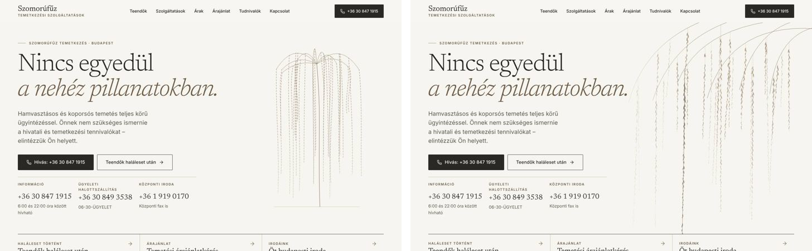
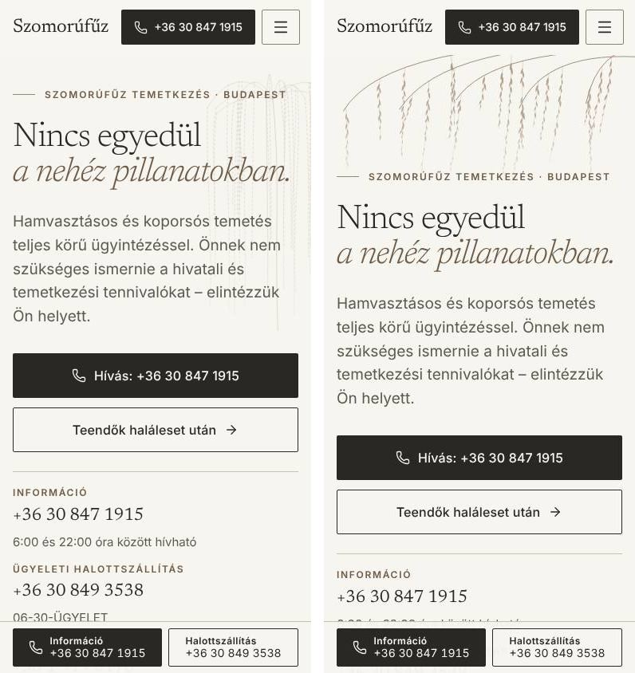
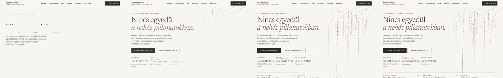
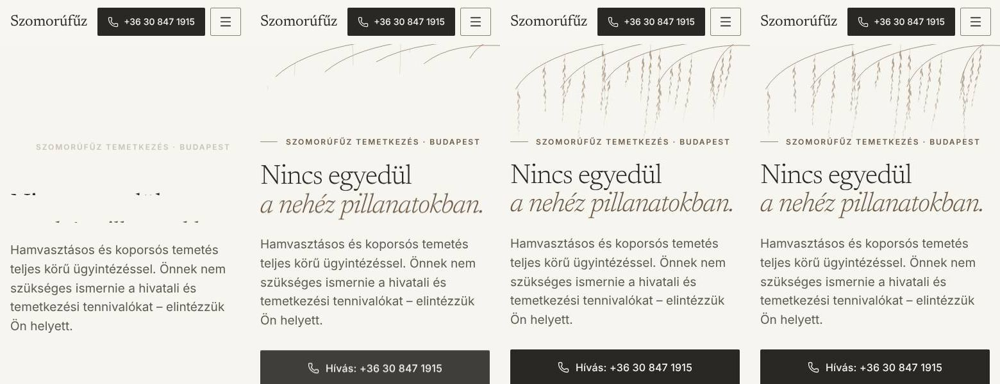
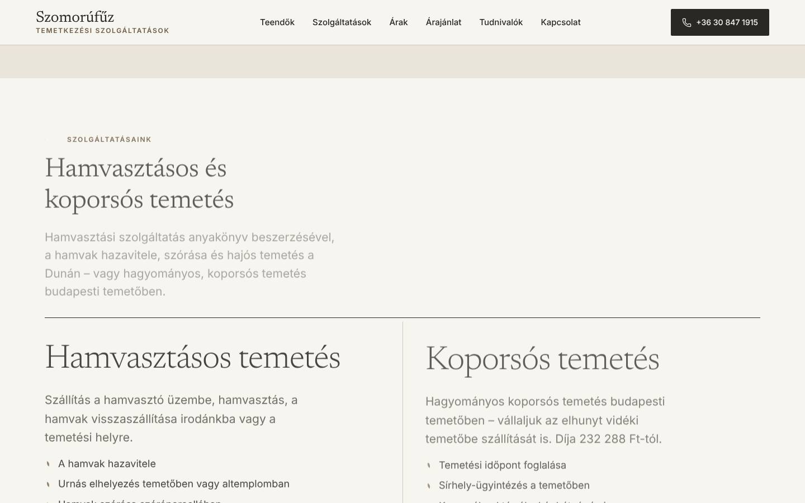
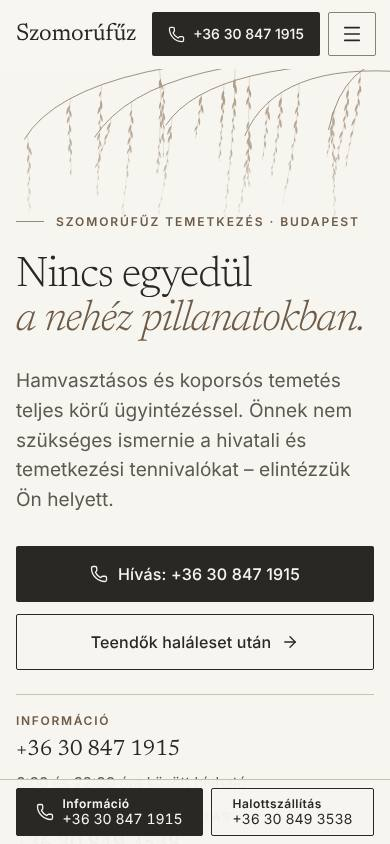

# Motion design – Premium Editorial Motion / Organic Minimalism / Cinematic Calm

Ág: `feat/premium-motion-experience` · Alap: `phase-1/foundation` @ `285ccc3` (PR #2 és #3 merge-elve)
· a skillek commitja (`eeb433e`) cherry-pickkel átvéve (`59cfd34`) · Dátum: 2026-11-03

## 1. Vizuális koncepció

**„A fa alatt állunk.”** A korábbi hero-fa különálló, szimmetrikus, legyező formájú
vonalrajz volt a jobb oldalon (esernyőre vagy szökőkútra emlékeztetett), egyszer megjelent,
majd statikus maradt. Az új motívum nem kirakott tárgy, hanem lombkorona:

- az ívelt ágak a képen kívülről, a jobb felső sarokból érkeznek, előbb szinte
  vízszintesen futnak, majd a végük kecsesen lehajlik;
- a csüngő vesszők keskeny, kitöltött lándzsás levelekkel hullanak alá, szabálytalan
  ritmusban, erősen eltérő hosszal, és lefelé feloldódnak a papírszerű háttérben;
- egyetlen **bronz kísérő vessző** a hero aljáig ér, és ott találkozik a következő
  szekció felrajzolódó vonalával – ez köti össze a herót a tartalommal;
- a tipográfia érintetlen (Newsreader + Inter), a címsor jobb vége mellett az első vesszők
  halványan kapcsolódnak a szöveghez.

Kompozíciók szélesség szerint (nem kicsinyítés, hanem külön tervezés):

| Szélesség                | Kompozíció                                                                      |
| ------------------------ | ------------------------------------------------------------------------------- |
| < 48em (320–767 px)      | teljes szélességű „lombfüggöny” a cím fölött – a cím a fa alatt áll             |
| 48–63em (tablet)         | keskenyebb, jobbra igazított lombfüggöny (természetes levélméret)               |
| ≥ 64em (asztal)          | a korona a jobb hasáb fölé borul, a viewport széléig fut ki; két mélységi réteg |
| aloldal, CTA-sáv, lábléc | statikus sarokkorona (papír / sötét színvilág), animáció nélkül                 |

## 2. Motion design terv

### Hero – egyszeri, ritkán látott belépő (≤ 4,6 s, utána nyugalom)

| Idő          | Elem               | Mozgás                                                                        | Görbe           |
| ------------ | ------------------ | ----------------------------------------------------------------------------- | --------------- |
| 40–940 ms    | címke vonala       | felrajzolódik (scaleX)                                                        | `--ease-in-out` |
| 60–760 ms    | címke              | emelkedés + halványodás                                                       | `--ease-out`    |
| 120–1230 ms  | címsor 2 sora      | soronként maszkból emelkedik (100 ms eltolás)                                 | `--ease-out`    |
| 300–1400 ms  | bevezető           | 10 px elmozdulás, **halványodás nélkül** (LCP az első képkockától)            | `--ease-out`    |
| 420–1460 ms  | gombok, telefonsor | lépcsőzetes belépés (70 ms)                                                   | `--ease-out`    |
| 80–1950 ms   | ágak               | felrajzolódnak                                                                | `--ease-out`    |
| ~300–2600 ms | vesszők            | a szár felrajzolódik, a levélsor fentről lefelé feltárul                      | `--ease-out`    |
| 850–2150 ms  | szekcióvonal       | felrajzolódik a hero alján                                                    | `--ease-in-out` |
| 950–2550 ms  | bronz vessző       | leér a szekcióvonalig                                                         | `--ease-out`    |
| 1700–4600 ms | korona (asztal)    | egyszeri, csillapodó megnyugvás: 2 réteg, eltérő fázis/amplitúdó (±0,4–0,55°) | szinusz in-out  |

5 másodpercen belül minden időalapú animáció véget ér (WCAG 2.2.2 – nincs szükség
szüneteltetésre); a motion-QA ezt méri.

### Görgetéshez kötött mozgás (főoldal)

- **Mélység (asztal):** a korona hátsó rétege 90 px-t, az első 36 px-t mozdul az első
  viewportnyi görgetés alatt – natív CSS scroll-timeline, csak `transform`, a kompozitorban.
  Ahol nincs támogatás, a korona statikus. Nincs scroll-jacking, a görgetés nem lassul.
- **Szekcióbelépések:** minden szekciófejléc és tartalomcsoport **egyszer** lép be, amikor
  a nézetbe ér: a címke vonala felrajzolódik, a fejléc elemei lépcsőzve emelkednek (18 px),
  a csoportok elemei 70 ms-onként követik egymást. JS nélkül, IntersectionObserver
  hiányában és nyomtatáskor minden azonnal látszik.

### Interakciók

| Elem                         | Mozgás                                                                                                                                       | Cél                                    |
| ---------------------------- | -------------------------------------------------------------------------------------------------------------------------------------------- | -------------------------------------- |
| Gombok                       | `:active` scale(0.97), 160 ms                                                                                                                | visszajelzés                           |
| Nyíl-hover (kártyák, listák) | 3–4 px, csak egérrel                                                                                                                         | visszajelzés; érintésen nem „ragad be” |
| Szolgáltatáskártyák          | bronz vonal rajzolódik a kártya tetejére (hover + fókusz), 300 ms                                                                            | állapotjelzés, a hero vonalnyelve      |
| Helyzetválasztó              | lenyomás scale(0.98)                                                                                                                         | visszajelzés                           |
| Tartalomjegyzék / horgonycél | a célcímsor alá bronz vonal húzódik a sima görgetés után; irodakártyánál a római szám bronzra vált                                           | tájékozódás („itt vagy”)               |
| Mobilmenü                    | panel beúszik (`--ease-drawer`, 240–300 ms), menüpontok 30 ms-os lépcsőzése, zárás 160 ms; menü/X ikon áttűnés; **billentyűzettel azonnali** | térbeli kapcsolat, állapotjelzés       |
| Galéria                      | nyitás/zárás halványodás + scale(0.97), képváltás áttűnés 2 px elmosással; **billentyűzettel azonnali**                                      | megelőzi a hirtelen váltást            |

**Szándékosan nincs mozgás:** űrlapmezők, hibák, hibaösszesítő, küldés; mobil hívósáv és
sürgős telefonszámok; árak („felpörgetés” nincs); billentyűs műveletek; aloldal-herók
(gyakran látott felület); egérkövetés, erős parallax, részecskeeffektus.

### Mozgás-tokenek (`src/styles/tokens.css`)

`--ease-out: cubic-bezier(0.23, 1, 0.32, 1)` · `--ease-in-out: cubic-bezier(0.77, 0, 0.175, 1)` ·
`--ease-drawer: cubic-bezier(0.32, 0.72, 0, 1)` · `--duration-press: 160ms` ·
`--duration-exit: 160ms` · `--duration-reveal: 900ms` ·
`--stagger: 70ms` (a meglévő `--ease-standard` és `--duration-*` megmaradt).

### Csökkentett mozgás és JavaScript nélkül

- `prefers-reduced-motion: reduce`: a korona és a címsor azonnal, teljes formában látszik;
  a kulcskockás animációk azonnal véget érnek; átmenet csak nem-mozgató tulajdonságon
  marad (átlátszóság, szín) – a szekcióbelépések csak halványodnak. A korábbi globális
  „minden átmenet 0,01 ms” szabály helyett: „kevesebb és szelídebb, nem nulla”.
- JS nélkül: a hero CSS-animációi lefutnak és látható állapotban állnak meg; a görgetési
  belépések rejtett kezdőállapota csak `.js` alatt él.

## 3. Technikai megvalósítás

| Fájl                                                                                                                | Szerep                                                                                                         |
| ------------------------------------------------------------------------------------------------------------------- | -------------------------------------------------------------------------------------------------------------- |
| `src/lib/canopy.ts`                                                                                                 | determinisztikus, build idejű korona-generátor (hero / valance / corner), önálló SVG-renderelők, tartalom-hash |
| `src/pages/media/canopy-[name].svg.ts`                                                                              | statikus SVG-fájlok: `hero-back`, `hero-front` (animált), `corner-paper`, `corner-ink`                         |
| `src/components/brand/WillowCanopy.astro`                                                                           | beágyazott mobil/tablet lombfüggöny                                                                            |
| `src/components/brand/CanopyCorner.astro`                                                                           | statikus sarokkorona (aloldal-hero, CTA-sáv, lábléc); a régi `Willow.astro` törölve                            |
| `src/components/home/HeroSection.astro`                                                                             | hero-kompozíció, belépő, megnyugvás, scroll-timeline                                                           |
| `src/components/motion/RevealScript.astro` + `src/styles/global.css`                                                | görgetési belépések                                                                                            |
| `Button`, `ServicePaths`, `Card`, `ArticleIndex`, `ArticleBlocks`, `OfficeList`, `Header`, `Gallery`, `index.astro` | interakciók                                                                                                    |

**Technológia:** CSS transitions és animations, SVG, `@starting-style`, CSS scroll-timeline,
IntersectionObserver, Web Animations API (galéria-képváltás). Animációs könyvtár (GSAP,
Motion) **nincs** telepítve – a meglévő eszközök minden mozgást lefedtek, külső JS 0 bájt.

**Az asztali korona képfájlként töltődik:** `<picture>` + `media="(min-width: 64em)"`, így
mobilon nem töltődik le (0 bájt); a fájl tartalom-hash-sel verziózott. A beágyazott változat
a HTML-t 53 KB-ra növelte volna (gzip), a mostani megoldással 26 KB.

## 4. Teljesítmény (előtte → utána)

Lighthouse 12, mobil profil (szimulált lassú 4G, 4× CPU), helyi emulátor gzip-pel,
3-3 futás:

| Oldal                             | Teljesítmény | LCP       | FCP       | CLS | TBT  |
| --------------------------------- | ------------ | --------- | --------- | --- | ---- |
| `/` előtte                        | 95–96        | 2,9 s     | 1,1–1,2 s | 0   | 0 ms |
| `/` utána                         | 95–96        | 2,7–2,9 s | 1,1 s     | 0   | 0 ms |
| `/teendok-halaleset-utan/` előtte | 95–96        | 2,9 s     | 1,1 s     | 0   | 0 ms |
| `/teendok-halaleset-utan/` utána  | 95–96        | 2,8–2,9 s | 1,1 s     | 0   | 0 ms |

Képkocka-időzítés a hero animációja alatt (4× CPU-lassítás, DPR 2; motion-QA):
390 px: p95 17 ms, 0 elejtett kocka · 1440 px: p95 17 ms, 0–2 elejtett kocka (előtte 0–1).

Méret (főoldal): külső JS 0 B → 0 B · beágyazott JS 1,0 KB → 2,5 KB · HTML (gzip) 20,7 KB →
26,0 KB · asztali korona-fájlok +21 KB (gzip, csak asztalon, gyorsítótárazva).

**Célok:** CLS ≤ 0,1 – teljesül (0, mozgás közben is). Folyamatos mozgás mobilon – teljesül
(laborban). Főszál-terhelés – TBT 0 ms. **LCP ≤ 2,5 s – nem teljesül** (2,7–2,9 s, változatlan
az ág előttihez képest): az LCP-elem a bevezető bekezdés, a késés 85%-a a betűtípusok
betöltése (render delay). A mozgás ezt nem rontja – a bevezető szándékosan nem halványodik.
Javaslat (dizájndöntés): betűtípus-részhalmazolás vagy `font-display: optional` a törzsszövegre.

## 5. Skill-használat és review

- **emil-design-eng, animate, animation-vocabulary** – döntési sorrend (kell-e mozgás →
  cél → eszköz → tulajdonság → görbe/időtartam → megszakítás → csökkentett mozgás), az
  erős görbék és időtartamok, `@starting-style`, `clip-path`, lenyomás-visszajelzés.
- **find-animation-opportunities** – a megtartott lehetőségek a 2. fejezet táblázatában;
  elutasítva (és miért): űrlapok és hibák (funkcionális felület), mobil hívósáv (sürgős,
  gyakori), árak animálása (olvasott adat), billentyűs műveletek (100+/nap), aloldal-hero
  belépők (gyakori), egérkövetés/parallax/részecskék (a brief tiltja, figyelemelvonó).
- **improve-animations** – a meglévő mozgás felmérése: egyetlen gyenge görbe
  (`--ease-standard`), szabályozatlan hover-elmozdulások érintőképernyőn, csak nyitáskor
  animált mobilmenü, egyszer lefutó maszkos fa, a mindent nullázó csökkentett-mozgás szabály.
- **animation-performance** – mérés és javítás:

| Elem                         | Ok                                                                           | Előtte                        | Utána                                                                 | Ellenőrizve                       |
| ---------------------------- | ---------------------------------------------------------------------------- | ----------------------------- | --------------------------------------------------------------------- | --------------------------------- |
| Asztali korona megnyugvása   | SVG-n belüli `rotate` egy képben → teljes kép újrarajzolása minden képkockán | 6–8 elejtett kocka a fázisban | 2 HTML-rétegen önálló `rotate`, kompozitor: 0                         | mérve (4× CPU)                    |
| Görgetési mélység            | a minifikáló a `animation-timeline`-t a rövidítésbe olvasztotta → hatástalan | nem működött                  | külön szabály; `transform` a kompozitorban                            | mérve (getAnimations)             |
| Vesszők felrajzolása         | `stroke-dashoffset` / SVG `clip-path` = festés                               | –                             | megtartva (a koncepció része); mobilon 0, asztalon 0–2 elejtett kocka | mérve; valódi eszközön rögzítendő |
| Szárak „csíkjai”             | a csoport kitöltése a nyitott szárgörbéket is kitöltötte                     | látható csíkok                | `fill: none`                                                          | vizuálisan                        |
| Szekcióbelépés, menü, gombok | csak `transform`/`opacity`; `--i` az elemen magán (nincs öröklődő változó)   | –                             | rendben                                                               | kódból                            |
| Galéria-képváltás            | 2 px elmosás (< 20 px)                                                       | –                             | rendben                                                               | kódból                            |

- **review-animations** – ez a skill csak a felhasználó saját parancsával indítható
  (`disable-model-invocation`); az ügynök nem futtathatja és nem utánozhatja. **Teendő:**
  futtasd a `/review-animations` parancsot a `feat/premium-motion-experience` ágon; a
  jelentős megállapításokat ezután javítom.

## 6. Vizuális ellenőrzés és QA

`npm run qa:motion` (31/31): képsor 320/390/768/1440 px-en, 5 s után nincs futó időalapú
animáció, CLS 0 mozgás közben, nincs vízszintes túlcsordulás, natív görgetés, a belépő
fejléc teljesen látszik, csökkentett mozgásnál azonnal teljes kép és nincs elmozdulás, JS
nélkül nincs rejtve maradó tartalom, az asztali korona-fájl mobilon nem töltődik le,
képkocka p95 ≤ 17 ms (4× CPU). Képek: `docs/screenshots/motion/utana/`.

A meglévő QA változatlanul zöld: `npm run verify` (38/38 teszt), `qa:audit` 303/303
(a kontraszt-mérés most nyugalmi állapotban fut – `scripts/qa/settle.mjs`: a QA végiggörget,
és megvárja az animációk végét; animáció közben az átlátszó szöveget az axe tévesen
gyenge kontrasztúnak látta), `qa:browser`, `qa:forms` 45/45, `qa:gallery` 16/16,
`qa:urls` 48/48, `qa:content`.

## 7. Nyitott pontok

1. `/review-animations` futtatása a felhasználó részéről (lásd 5.).
2. Valódi eszközös ellenőrzés (közepes kategóriás Android, iPhone Safari): a vonalrajz
   festési költsége és a scroll-timeline (Safari 26 előtt nincs – ott a korona statikus).
3. LCP 2,5 s alatti cél: betűtípus-stratégia (dizájndöntés).
4. Galéria-átmenetek éles képekkel: a képek jogtisztázása után (jelenleg csak a /stilus/
   oldal tesztmintáin ellenőrizve).
